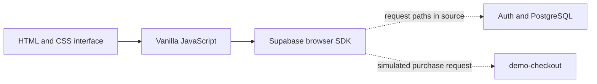

# Mission 008B — Project Exhibition Design & Architecture

Completed: 2026-11-23 (Asia/Barnaul). Design and planning only.

## 1. Design objectives and evidence

The exhibitions extend **Hybrid Exhibition — A precise gallery with living
interruptions** through editorial DOM content below the existing gallery.
They present two featured projects: IcaMeal and Blender. Blender contains two
modeling/material studies and a visibly separate imported-asset integration study.

The proposal preserves the opening Mission 004 composition and Missions 006–007:
the existing header, hero, work labels, architectural portal, plinth, Maple,
lighting, camera framing, inspection control, motion preferences and rendering
lifecycle. The project experience adds a reading destination; it does not turn
the gallery into an interactive 3D case-study viewer.

Design priorities:

- Lead with an actual artifact and a short explanation of its purpose.
- Use numbered chapters, varied image proportions, generous space and concise
  exhibition labels to establish a curated sequence.
- Keep source images truthful and distinguish the work, references and limitations.
- Make chapter navigation, project switching and returning to the gallery work
  with keyboard, touch and ordinary page scrolling.
- Use the existing DOM palette and typography; keep the product's own colors and
  typography inside its screenshots.
- Make useful content readable without animation, WebGL, hover or image zoom.

Sources read: [Mission 008A](MISSION-008A.md), the current application and styles,
[approved prototype](mission-004b.html), gallery screenshots, IcaMeal screenshots,
[project documentation](source-assets/icameal/documentation/README.md) and
[Supabase setup](<source-assets/icameal/source code/SUPABASE_SETUP.md>).
All proposals below concern future Mission 008C work; none is implemented here.

### Confirmed authorship updates

The latest Mission 008B brief supplies the following owner confirmations. They
supersede the earlier unknown authorship status for these two studies in 008A.
The historical audit is preserved rather than rewritten.

| Study | Confirmed contribution | Required display wording / boundary |
| --- | --- | --- |
| 2 Plants Weird | Geometry follows a tutorial; owner independently modified shading and materials | “Tutorial-based modeling with independent material and shading exploration.” Do not imply original geometry from scratch or ownership of the tutorial |
| Fire Sprinkler | Owner modeled it from scratch using images as visual references | “Original modeling from visual references, with material and particle-system experimentation.” Reference photography/HDRI ownership remains separate |
| Japanese Maple | Imported asset integration | “Imported asset integration: material compatibility, placement, rendering and interaction.” No owner mesh/rig credit; creator/license unresolved |
| IcaMeal | Audited frontend prototype and documented product purpose | Describe the project and evidence; do not add sole-authorship, collaborator, duration, client or personal-role claims without confirmation |

### Current asset paths

The two Blender files are now at:

- [2 plants weird.blend](<source-assets/blender/blend-files/2 plants weird.blend>)
- [fire sprikler.blend](<source-assets/blender/blend-files/fire sprikler.blend>)

Their SHA-256 values match the files inspected during 008A; that report's
`public/projects/` paths are historical. No renders or process images are
present in the current Blender source folder.

The gallery export remains at `public/models/japanese-maple.glb`, with its original
hash. The Maple BLEND at the historical 008A path is not present in the current
workspace snapshot. Existing reports, screenshots and the preserved GLB support
the integration chapter; locate the editable original only if later source-level
work or source-integrity checks require it. This mission did not relocate assets.

## 2. Exhibition information architecture

### One page, one active exhibition

Recommend an **inline article after the opening gallery stage and before the
existing Studies / About / Contact sections**. The work buttons activate one
project at a time. No project is open on a normal initial gallery visit.

The gallery remains mounted in its original location. Scrolling into a project
naturally pauses its offscreen work through the existing activity hook. No
additional Canvas, model viewer, AnimationMixer or camera-navigation system is
required for the exhibitions.

```text
EXISTING GALLERY
  Header: Work / Studies / About / Contact
  Hero copy + architectural gallery + Inspect Specimen
  Featured work: IcaMeal / Blender
                    |
                    | activate a project and scroll
                    v
ONE ACTIVE EXHIBITION
  Project title, scope and introductory artifact
  Chapter index + project-specific sequence
  Return to gallery / switch featured project
                    |
                    v
EXISTING EDITORIAL SECTIONS
  Studies / About / Contact
```

Returning to the gallery leaves the selected article below it. That retains page
height and avoids collapsing content while the visitor scrolls back. Selecting
the other project replaces the active article and lands at its introduction.
An inactive project is absent from the reading/focus order.

### IcaMeal chapter sequence

| Chapter | Display heading | Proposed fragment |
| --- | --- | --- |
| 01 | IcaMeal — Overview | `#project-icameal` |
| 02 | Visual identity and direction | `#project-icameal-identity` |
| 03 | Budget planner and weekly menu | `#project-icameal-budget` |
| 04 | Recipe catalog and shopping checklist | `#project-icameal-recipes` |
| 05 | Monthly calendar and Good Food Club | `#project-icameal-access` |
| 06 | Frontend architecture and Supabase | `#project-icameal-architecture` |
| 07 | Technical decisions, limitations and reflection | `#project-icameal-notes` |

Short index labels: Overview, Identity, Budget & week, Recipes & shopping,
Monthly & club, Architecture, Notes. The full headings remain descriptive.

### Blender chapter sequence

| Chapter | Display heading | Proposed fragment |
| --- | --- | --- |
| Introduction | Blender — Studies in geometry and material | `#project-blender` |
| Study 01 | 2 Plants Weird | `#project-blender-plants` |
| Study 02 | Fire Sprinkler | `#project-blender-sprinkler` |
| Integration study | Japanese Maple | `#project-blender-maple` |
| Closing notes | Scope, unfinished work and credits | `#project-blender-notes` |

Plants and Sprinkler remain numbered studies within Blender. Maple is labeled
“Integration study” and separated by an editorial rule; it is not framed as a
third owner-modeled specimen. A study index replaces a gallery of unrelated cards.

### Heading and content hierarchy

The existing portfolio heading remains the document's H1. An inline project title
is H2; its numbered chapters/studies are H3; focused material, implementation and
credit subtopics may use H4. Figures and captions belong beside their chapter.

Use short introductions of approximately 50–80 words and chapter notes generally
60–100 words; the technical limitations chapter may be longer. These are editorial
length targets, not measured reader behavior. Every major image has a nearby DOM
explanation, not a screenshot as the sole source of information.

## 3. Detailed section layouts

### IcaMeal 01 — Introduction and overview

Lead with the project name, the classification **Frontend prototype**, a short
documented purpose for students/anak kos, and a discreet **Checkout simulated**
scope line. Do not place invented role, duration, client or launch-date fact cards.

Desktop: title occupies the left five grid columns; scope and short introduction
occupy the right five/six. Below that, a single wide artifact spans the reading
area. Prefer `bahan.png` as the first release candidate while the Uchiko hero
photo is uncleared: its forest-green shopping interface links visually to the
gallery and describes a useful product task. If photo rights are resolved,
`hero.png` becomes the visual-direction opener instead.

Mobile: title, scope, paragraph, artifact, caption and index stack in that order.
Retain the image's full intrinsic ratio. The caption explains the interface even
when its captured labels are too small to read at mobile width.

Suggested evidence-based purpose copy:
“IcaMeal is a frontend prototype for students planning a weekly menu around a
budget and eating preferences.” Personal contribution copy remains pending.

### IcaMeal 02 — Visual identity and design direction

Present the observed cream/forest-green/terracotta/gold product treatment, large
wordmark, Fraunces headings, DM Sans controls and botanical strip as project
artifacts. The portfolio's outer text stays in its existing font stack and palette.

Desktop: a short typographic explanation precedes the contained botanical strip
and, if cleared, the hero screenshot. The SVG is a design detail, not a new site
decoration. Use its original aspect ratio; do not tile it across the portfolio.

Mobile: explanation, strip and eligible screenshot stack. Keep reference credit
immediately beside any reproduced photograph; do not hide it in a distant footer.

If the Uchiko photo is uncleared, the chapter can use the supplied vector detail,
the typography visible in later product screens and factual DOM text. Omit the
photo-dependent figure, without a fabricated substitute or blank image slot.

### IcaMeal 03 — Budget planner and weekly menu

Make this the central functional sequence: `anggaran.png`, then
`week plan.png`. Use two successive wide plates, not two small side-by-side
dashboard thumbnails. Their near-1.90:1 ratios remain intact.

Desktop: chapter number/heading and a concise note sit above the first plate;
a second note connects the budget choice to the seven-day plan before the next
plate. Captions identify the input, total/remaining budget, selected day and
locked cards. Supporting copy explains seven main-meal entries, recipe-tag
preferences, budget fallback and menu-order regeneration.

Mobile: keep the same sequence and provide a full-image link for each screen.
A future genuine mobile capture may supplement it, but a shrunk desktop capture
must not be labeled a mobile product view.

State that costs are recipe-record estimates and some budgets cannot be met.
Do not claim guaranteed affordability, medically validated nutrition or an
AI recommendation system.

### IcaMeal 04 — Recipe catalog and shopping checklist

Give the editorial recipe list and categorized checklist different visual roles:
`katalog.png` is a full-width recipe-index plate; `bahan.png` is a lower, panoramic
shopping plate. A brief passage between them connects choosing recipes to reading
ingredients and tracking purchases.

The catalog capture contains a translucent hover-preview state. Keep it as
interaction evidence if useful; request a clean capture for polished presentation.
Do not reconstruct an interactive recipe index from the screenshot.

On desktop, put short explanatory notes beside the heading, then let both images
span the full reading width. On mobile, use one column, clear descriptions and
full-image links. Never put captured checkbox rows into a new horizontally
scrolling portfolio panel.

Include a quiet, visible link to the limitations chapter:
“Repeated recipes can undercount ingredients in the current prototype.”
That defect remains unresolved. The exhibition checklist is an image of the app,
not a live editable shopping list. An open ingredients/steps dialog capture is
optional supporting material and currently missing.

### IcaMeal 05 — Monthly calendar and Good Food Club

Use `monthly plan.png` as the primary calendar figure, followed by a smaller
`footer.png` membership/offer figure and the adjacent **Simulated checkout**
caption. The narrative concerns access design, not commercial traction.

Desktop: calendar remains wide; the membership figure may occupy eight reading
columns with a short scope note beside it. Preserve the calendar's approximately
1.89:1 ratio and the membership capture's approximately 2.50:1 ratio.

Mobile: calendar, scope note and membership figure stack. A better calendar
capture with its heading fully visible is desirable, not grounds for inventing
a new state.

Explain the source's membership/monthly entitlement gate and 30-day catalog
rotation. Do not promise a budget/diet-optimized month. Favorites are not listed
as a delivered feature. If the supplied membership capture shows a favorites
promise, the nearby caption explicitly identifies it as unimplemented copy;
do not silently present it as delivery evidence. Price labels are snapshot values,
not revenue, transaction or adoption metrics.

### IcaMeal 06 — Frontend architecture and Supabase integration

Give this chapter an editorial diagram and two short explanatory columns,
instead of an opaque screenshot of source code. The graph describes source-backed
frontend request paths; dotted backend connections make the verification boundary
visible.



Caption: “Frontend files and client calls are present. The full server schema,
policies, checkout function and live behavior were not verified in the audit.”

Desktop: diagram spans the reading area; below it, one column describes temporary
guest state and another describes authenticated database requests. Mobile: a
vertical diagram arrangement and successive text blocks avoid horizontal scrolling.
A prose explanation repeats the diagram's meaning.

Mention the two supplied incremental migrations and the SDK session behavior.
Keep credentials and project configuration values out of exhibition copy.
Do not execute IcaMeal's app or Supabase client inside the portfolio, embed a
live checkout, or attribute React/Vite to the IcaMeal implementation.

### IcaMeal 07 — Technical decisions, limitations and reflection

Conclude with observed implementation decisions and a restrained “Current limits”
text block. Use a small terracotta chapter marker/left rule, graphite body text
and normal spacing, rather than a dramatic error panel.

The unresolved repeated-recipe defect must be readable without opening an
accordion: aggregation stores one servings value per recipe ID, so a repeated
recipe can be counted once rather than once per planned serving. The audited
100 g versus 200 g example is a synthetic diagnostic, not a customer result.

Also retain the budget-minimum fallback, simple monthly catalog rotation,
unverified backend/RLS/checkout deployment, absent favorites and photo-attribution
issues as relevant limits. Source-backed explanations can be written now.
Personal lessons, intent, satisfaction, feedback and next-work commitments require
the owner's words. If those remain unsupplied, use **Current limits and possible
next work**, not a fabricated first-person reflection.

Finish with “Return to gallery” and “Read Blender” links. No live-demo CTA is
proposed without a verified destination and a clearly defined demo scope.

### Blender introduction — One exhibition, multiple studies

Use “Blender” as the H2 and an introduction that distinguishes geometry,
materials and integration. An index lists Plants, Sprinkler and Maple integration.

Desktop: generous title block with a small contribution key, then a primary
foliage image once supplied. The contribution key uses textual labels:
**Tutorial-based geometry / Independent shading**, **Original modeling /
Visual references**, **Imported asset / Integration**.

Mobile: introduction and key stack; long labels wrap naturally. No new specimen
selector, Canvas or orbit control is introduced.

The lead image is an approved future plant beauty view. Until one exists,
the design specification remains complete but the visual Blender exhibition is
not ready to publish. Do not fill it with Maple or a generated plant placeholder.

### Blender Study 01 — 2 Plants Weird

Lead with the confirmed statement:
“Geometry follows a tutorial; shading and materials were independently modified.”

Then show a full-silhouette plant view, a material/leaf detail, and one focused
process figure. The existing file contains several arrangements; select the view
after a real visual review rather than promising exactly two finished specimens
from its filename.

Desktop: primary figure spans the reading width at a proposed 3:2 ratio.
Below it, a 4:5 leaf/material detail can occupy five columns beside a short
description. A material graph or modifier view follows at 4:3 or its natural ratio.
Mobile: primary image, note, detail and process view stack; never clip leaf tips
to achieve a fixed hero height.

Describe the stored Array/Solidify/Subdivision approach and current shader graph
as file evidence. Owner modification credit is specifically for material/shading
exploration; do not assume the owner independently authored every node or invented
the geometry method. Tutorial author/title/source is still needed for attribution.

No before/after comparison is specified as existing evidence: a tutorial baseline
or earlier material variant is not supplied. Add such a comparison only if the
actual assets and appropriate reference credit become available.

### Blender Study 02 — Fire Sprinkler

Lead with **Original modeling from scratch by the owner**, followed by
“Visual references informed the form; material and particle work remain studies.”

Primary figure: an approved three-quarter hardware view at 3:2.
Supporting figure: glass bulb/brass/metal detail at 4:5 or square.
A topology/modifier figure at 4:3 explains the hard-surface work.
The source's reference JPEGs may appear only as clearly captioned references
after their origin/permission is established.

Desktop: primary image above; detail and short material notes form a balanced
two-column composition below. On mobile, keep form, material detail and process
in successive blocks.

A small optional subtopic **Particle-system experiment** may show settings or a
verified owner-supplied video. Currently only configuration is evidenced:
Newtonian object-instance particles and collision surfaces. Do not call it a
finished fire, water or spray simulation. No autoplay, simulation baking or
interactive particle reconstruction is part of the proposed exhibition.

Original modeling credit does not extend to the packed HDRI, reference photographs
or Blender's linked essentials node group.

### Blender integration study — Japanese Maple

Separate this chapter with additional space and an explicit **Imported asset
integration** label. Keep the credit/scope text visible at the same level as the
figure caption.

Use the existing clean gallery screenshot for context and, if rights allow,
the original-material screenshot versus the final red foliage image for a
material-compatibility comparison. Those are real integration iterations.
On desktop, a context plate spans the reading area, followed by two smaller
comparison figures with synchronized captions. On mobile, the comparison stacks;
no slider is required.

A link labeled “View specimen in the gallery” returns to the existing figure and
focuses its Inspect Specimen control when available. The link does not
automatically activate camera inspection.

Discuss compatibility, parent placement/scale, rendering choices and the DOM
inspection interaction. The original mesh, rig and sway clip are imported.
Creator/licensing remain unresolved; do not replace that gap with owner authorship.
If new-publication permission is not resolved, withhold the corresponding new
exhibition figures and keep the existing gallery behavior unchanged.

### Blender closing notes

End with brief scope/credit notes and available, evidenced limitations:
unreviewed presentation renders, tutorial/source attribution, particle playback
not established, and external reference/HDRI rights. Add personal reflection only
when supplied by the owner.

Provide “Return to gallery” and “Read IcaMeal” links. This is the end of one
Blender exhibition, not a launch point for additional unapproved 3D projects.

## 4. Desktop/mobile composition, typography and spacing

### Shared visual system

| Element | Proposal for exhibition content |
| --- | --- |
| Palette | Reuse ivory `#f1efe8`, raised ivory `#e5e1d7`, graphite `#242520`, botanical green `#536348`, terracotta `#9a4934`, muted `#55574f` |
| Typography | Reuse Instrument Sans/Arial and IBM Plex Mono/Courier New stacks; no new portfolio fonts |
| Project H2 | Approximately 48–64 px desktop, 32–40 px mobile; weight 500, restrained negative tracking |
| Chapter H3 | Approximately 28–34 px desktop, 24–28 px mobile |
| Body | 16–18 px, 1.6 line-height, generally 55–65 characters per line |
| Captions/credits | 12–13 px, 1.5 line-height; important scope notes in body size |
| Chapter/index labels | 11–12 px mono; title case for navigation, limited uppercase for short exhibition labels |
| Section spacing | 96–112 px desktop; 56–64 px mobile |
| Heading/body gap | 16–24 px |
| Figure/caption gap | 8–12 px; separate text/next figure by 24–32 px |
| Media frame | Rectangular, thin raised-ivory edge, 16–24 px inset desktop and 8–12 px mobile |
| Interaction accent | Small terracotta underline/marker; existing green focus outline, not color alone |

These measurements apply only to new exhibition content. The existing hero title,
header dimensions, gallery footprint, portal proportions and mobile breakpoint
remain as approved. IcaMeal's gold/Fraunces/DM Sans remain visible in its artifacts,
not new tokens for the portfolio.

### Desktop above 1000 px

Use a centered container capped around 1240 px with the existing approximately
7% page gutters. A 12-column grid has 24 px gaps. Introduction title/summary span
the wide grid; images occupy substantial reading space.

Below the introduction, a two-column-width chapter rail sits beside a
ten-column-width reading area. The rail may stick at 24 px from the viewport top
and ends with the article. It is navigation, not a permanent second site header.
If its content cannot fit a short viewport, keep it in normal flow.

Major UI screenshots stay full-width within the reading area. Side-by-side
figures are reserved for uncluttered material details and comparison images,
not dense dashboards.

```text
DESKTOP EXHIBITION — separate from the existing gallery composition
+----------------------------------------------------------------+
| 01 / ICAMEAL                 Frontend prototype                  |
| IcaMeal                      Purpose / scope / simulated checkout |
|                                                                |
| [introductory artifact, full intrinsic ratio]                    |
| Caption and source/credit                                       |
+------------------+---------------------------------------------+
| CHAPTER INDEX    | 03  Budget planner and weekly menu            |
| Overview         | Short evidence-based introduction             |
| Identity         |                                              |
| Budget & week    | [wide budget screen]                         |
| Recipes/shopping | Caption                                      |
| Monthly/club     | [wide weekly screen]                         |
| Architecture     | Caption                                      |
| Notes            |                                              |
| Return to gallery| Next chapter                                 |
+------------------+---------------------------------------------+
```

### Medium widths, 801–1000 px

The opening gallery still follows its current responsive rules.
For the exhibition only, move the chapter index above the narrative, allow it
to wrap, and use one reading column. Small comparison/detail pairs may stack.
No new global breakpoint or header redesign is proposed.

### Mobile, 800 px and below

Reuse the current 24 px side margins, including at 320 px. Use one content column,
16 px internal gaps and the smaller media inset. The chapter index remains in
normal flow; its short links may form two columns with at least 44 px target
height. Avoid a sticky chapter bar covering the content.

The reading order matches DOM order. Images retain natural aspect ratios; captions
and source/limitation notes remain beside them. Full-image links are available
where dense screenshots require closer reading. Mobile source captures are useful
supplements, not a reason to mislabel resized desktop screenshots.

```text
MOBILE EXHIBITION
+------------------------------+
| Return to gallery            |
| IcaMeal / scope               |
| Short purpose                 |
| [artifact at natural ratio]  |
| Caption                       |
| In this exhibition            |
| Overview      Identity        |
| Budget/week   Recipes/...     |
| ...                           |
|                               |
| 03 Budget and weekly menu     |
| Explanation                   |
| [budget screen]              |
| Caption + View full image     |
| [weekly screen]              |
| Caption + View full image     |
|                               |
| Remaining chapters            |
| Return / Read other project   |
+------------------------------+
```

At 320 px the reading width is approximately 272 px before media insets.
Captured UI text cannot be made readable merely by scaling a 2500 px screenshot.
Provide a short DOM explanation of its important controls/state; a full image
destination gives optional native browser zoom without hijacking page scrolling.

## 5. Interaction and navigation specifications

### Project selection and fragment history

| Trigger | Required result |
| --- | --- |
| Activate IcaMeal or Blender work button | Set selected project, expose the corresponding article, navigate to its introduction and focus its H2 |
| Activate the already selected project | Return to its introduction; do not deselect or collapse it |
| Follow a chapter anchor | Reach the exact chapter and focus its H3; use native fragment history |
| Follow “Read Blender” / “Read IcaMeal” | Switch the single active article and land at its introduction |
| Follow “Return to gallery” | Navigate to `#featured-work`; restore focus to the originating work button or matching project button |
| Follow “View specimen in the gallery” | Navigate to `#botanical-study`; focus the existing enabled inspection control, otherwise the figure |
| Use global Work/Studies/About/Contact | Preserve existing targets and normal section navigation; selected content may remain below the gallery |
| Browser Back/Forward or initial project fragment | Resolve the matching project/chapter before target scrolling; keep native history semantics |
| Unknown fragment | Do not crash or force a project; retain normal gallery/navigation behavior |
| Escape while reading an exhibition | No exhibition dismissal: this is a document article, not a modal |
| Escape during gallery inspection | Preserve Mission 007 return-to-default camera behavior |

Recommended fragments are listed in section 2. A small explicit fragment-to-project
map handles initial loads and hash changes without a router/library. When a target
belongs to an inactive project, render that project before final scroll/focus.
Reserve image dimensions so later media loading does not move the destination.

Retain the work controls' semantic button selection and `aria-pressed` state;
add a meaningful `aria-controls` reference to a stable exhibition region.
A selected-state announcement remains unobtrusive. Only the active article is
reachable; two hidden-but-focusable project copies are not acceptable.

For return focus, keep an in-memory origin reference. Direct fragment visitors
have the matching work button as a fallback. Focus restoration uses
`preventScroll` after the intended target navigation. Do not change focus during
ordinary scrolling. Chapter anchors may mark their fragment destination with
`aria-current="location"`; continuous scroll tracking is unnecessary for this
first version.

### Transitions and gallery coordination

Content appears immediately when selected. Native CSS smooth scrolling provides
the move to its introduction; no fixed-duration page animation is needed.
Reduced motion uses immediate scrolling. A short color/underline transition
around 120 ms is optional for controls and disabled under reduced motion.

Project navigation is a DOM action. It does not orbit, zoom through the portal
or add camera choreography. Returning to the gallery requests its default
camera state (inspecting=false) through the existing camera path. If a return is needed,
reuse the existing 800 ms transition while active, or snap under reduced motion.
The settled camera must equal the approved initial position/target.

Keep one gallery instance mounted. Its current hidden/offscreen activity rules,
DPR, loading/error fallback, demand rendering and Maple sway remain intact.
No new continuous animation loop, mixer or invalidate-on-scroll behavior is
required. Project images and native media are DOM responsibilities.

### Image and optional video inspection

Use an explicit **View full image** anchor for eligible figures. Recommended
behavior is the original/approved full-resolution image in a new tab, with that
destination stated in the accessible label. Native browser zoom/scroll handles
detail; the portfolio stays available in its original tab.

Do not make the whole figure capture drags, implement a custom zoom/orbit canvas,
or turn screenshot buttons into misleading live product controls. Full-image
opening must also be available to keyboard users.

A future verified sprinkler video uses native controls, `playsinline`,
`preload="none"`, a real poster and a descriptive caption. It does not autoplay.
Pause user-started media when offscreen or the tab becomes hidden, retain its
position, and require user action to resume. Omit the video if playback evidence
is not supplied. Reduced-motion visitors can still deliberately choose to play it.

## 6. Asset placement and image requirements

### Existing IcaMeal media map

All paths below are relative to the workspace. Display captured interfaces with
their full content: `width: 100%`, intrinsic dimensions and natural height.
If placed in a fixed frame, use contain and ivory space; do not crop controls
or headings to force 16:9. No crops/conversions are created in this mission.

| Asset path | Actual size / ratio | Placement | Readiness / constraint |
| --- | --- | --- | --- |
| `source-assets/icameal/screenshots/bahan.png` | 2527 × 876 / 2.885:1 | Recommended initial opener; chapter 04 shopping detail | Existing image without food photography; avoid repeating the full figure twice if opener is used |
| `source-assets/icameal/screenshots/hero.png` | 2522 × 1331 / 1.895:1 | Alternative opener or chapter 02 identity | Uchiko photograph permission unresolved; no original-photo claim |
| `source-assets/icameal/screenshots/anggaran.png` | 2526 × 1332 / 1.896:1 | Chapter 03 budget plate | Adjacent hero material is visible at top; review included photo rights too |
| `source-assets/icameal/screenshots/week plan.png` | 2521 × 1327 / 1.900:1 | Chapter 03 weekly plate | Third-party food images; important functional image |
| `source-assets/icameal/screenshots/katalog.png` | 2518 × 1328 / 1.896:1 | Chapter 04 catalog plate | Hover preview is translucent; optional clean recapture |
| `source-assets/icameal/screenshots/monthly plan.png` | 2522 × 1333 / 1.892:1 | Chapter 05 calendar plate | Header partly clipped; optional clean recapture |
| `source-assets/icameal/screenshots/footer.png` | 2525 × 1008 / 2.505:1 | Chapter 05 access/offer detail | Simulated checkout and unimplemented favorites copy need adjacent scope notes |
| `source-assets/icameal/source code/assets/hero-botanical.svg` | 220 × 56 units / 3.929:1 | Contained design detail in chapter 02 | Project artifact, not a new portfolio background pattern |
| `source-assets/icameal/references/uchiko-hero-dry-aged-duck.webp` | 2880 × 2128 / 1.353:1 | Reference/attribution record only | Do not use as standalone owner-created project work |

If `bahan.png` opens the exhibition, chapter 04 references that figure and retains
the shopping explanation rather than reproducing the full screenshot again.
After a cleared `hero.png` becomes the opener, shopping takes its full chapter-04
position. This keeps the curated sequence concise.

### Requested Blender images

These are asset roles and requirements, not existing files or generated placeholders.
Final paths enter the media manifest only when real approved files are available.

| Asset role | Source / proposed ratio | Requirement |
| --- | --- | --- |
| Plant primary beauty view | `source-assets/blender/blend-files/2 plants weird.blend`; 3:2 | Essential: full silhouettes, deliberate arrangement, reviewed lighting/material appearance |
| Plant leaf/material detail | Same source; 4:5 or 1:1 | Useful for independent shading emphasis; render or viewport must show actual owner variant |
| Plant shader/modifier view | Same source; 4:3 or natural | Essential for the detailed process claim: readable, focused node/modifier evidence, not an invented before/after |
| Sprinkler primary view | `source-assets/blender/blend-files/fire sprikler.blend`; 3:2 | Essential: three-quarter assembly with form visible and no clipped components |
| Sprinkler metal/glass detail | Same source; 4:5 or 1:1 | Useful to show original modeling and material contrast |
| Sprinkler topology/modifier view | Same source; 4:3 or natural | Essential for detailed modeling process; keep annotation factual |
| Sprinkler playback/video | Same source; 16:9 with real poster | Optional; only after actual playback is reviewed |
| Tutorial reference | Actual tutorial source, presently unidentified | Citation essential; reproduced reference image optional and distinctly credited |
| Sprinkler reference/HDRI | Packed JPEGs and `construction_yard_4k.exr` identified in 008A | Establish origin/rights before reproduction; do not treat them as original photographs |

Target approximately 1800–2400 px on the long edge for desktop beauty views.
A distinct 4:5 mobile beauty view is optional where the wide view makes a subject
too small. Readable process images matter more than imposing a particular ratio.
No original BLEND is saved, re-rendered, unpacked or exported in this mission.

### Existing Maple integration images

- `artifacts/mission-006c/desktop-1440x900.png`: context plate, 1440 × 900, 1.60:1.
- `artifacts/mission-006c/original-materials/desktop-original-materials.png`:
  white-export diagnostic, 1440 × 900, 1.60:1.
- `artifacts/mission-007/desktop-inspection-1440x900.png`:
  closer-camera detail, 1440 × 900, 1.60:1; contains focus/selection UI.

These are browser captures of integration. Their scale and technical counts are
not physical-phone performance measurements. The clean 006C image is preferred
for context; the 007 image supports interaction discussion, not a replacement
owner modeling hero. New exhibition use remains subject to creator/license review.

### Missing-media behavior

Withhold an uncleared optional figure and keep the chapter's truthful DOM content.
Do not show blank frames, invented diagrams of unimplemented features or stock
replacement renders. If required Blender beauty/process images are still missing,
keep that exhibition as an internal implementation preview in 008C rather than
shipping a visibly unfinished modeling presentation. Preserve its existing work
selection behavior until a usable exhibition is ready.

Any full-resolution link requires an existing, eligible target. Missing images
remove the associated link; an unexpected runtime load error retains the figure's
short description/caption and does not remove chapter navigation.

## 7. Content and attribution rules

| Topic | Required treatment |
| --- | --- |
| IcaMeal maturity | “Frontend prototype”; distinguish source implementation, captured UI and unverified hosted backend |
| Checkout/access offers | “Simulated checkout”; no live payments, commercial launch, adoption, sales or recurring-billing claim |
| Favorites | Not implemented; no highlight card. Explain visible promise in membership screenshot if reproduced |
| Ingredient aggregation | Unresolved repeated-recipe undercount remains visible in chapter 07 and linked from shopping |
| Monthly planning | Source-backed 30-day calendar/catalog rotation, not a fully optimized nutritional/budget plan |
| Research/results | No invented research, metrics, user feedback, business outcome, testimonial or personal reflection |
| IcaMeal photographs | Identify external food photography separately from interface design; verify author/license records |
| Plant geometry | Tutorial-based; cite tutorial when known; no modeled-from-scratch claim |
| Plant material/shading work | Owner-confirmed independent modifications; do not invent specific changes or a missing baseline |
| Sprinkler model | Owner-confirmed original modeling from scratch, guided by visual references |
| Sprinkler simulation | Configured particle experiment; no finished fire/spray claim without playback evidence |
| Maple mesh/rig | Imported; original creator/license unresolved; integration contribution only |
| External references/HDRI | Credit independently; local presence or packing is not permission |
| Dates/roles/technologies | Only documented or owner-confirmed facts; never transfer the portfolio stack to IcaMeal |

Caption structure: **what is shown → what it demonstrates → appropriate source/credit
or limitation**. Keep it short; reserve technical detail for nearby body text.
The photography credit does not belong inside alt text instead of a visible caption.

Outer narrative is proposed in English, matching the current portfolio. Preserve
Indonesian text in screenshots and mark any reproduced Indonesian DOM quotation
with `lang="id"`. Do not translate a marketing promise into a verified feature.

The audit found apparent source/credit mismatches for `ayam-kecap` and
`sayur-lodeh`. Reconcile those records before reusing affected photographs.
This plan does not silently correct SQL or assume a permission grant.

## 8. Accessibility and reduced-motion requirements

Requirements for future implementation:

- Retain the main landmark, current skip link, semantic header anchors and one
  portfolio H1. New articles/chapters have associated headings and unique IDs.
- Keep project controls native buttons, chapter/return/full-image controls native
  links, and media native images/video. Use explicit labels and visible focus.
- Preserve the existing 2 px green outline; use at least the current 6 px offset
  where it is not clipped. Pressed/current state also uses text/underline.
- Provide at least 44 px target height for new controls; wrap navigation at 320 px
  without horizontal page overflow.
- Focus the destination heading on project/chapter activation. Restore the
  matching work-control focus on explicit gallery return. Do not trap focus or
  leave it in an unmounted project.
- Inactive content is absent/inert, not merely transparent or positioned offscreen.
- Images need accurate alt text and adjacent meaningful summaries of dense UI.
  Example: “IcaMeal weekly view with seven menu cards, four locked, and selected
  recipe nutrition.” Final Blender alt text must follow the real supplied image.
- Credits/limitations are ordinary readable DOM text. Do not hide the aggregation
  defect, simulated checkout label or authorship distinctions behind hover.
- Technical diagrams have a prose equivalent; mobile layout stays vertically
  readable and does not require dragging.
- `prefers-reduced-motion` removes smooth scroll/control animation; preserve
  Mission 007's immediate camera endpoint and static Maple behavior.
- Preserve native touch scrolling over Canvas and images. Images do not capture
  ordinary page gestures or disable zoom.
- Explicit full-image links announce the new-tab destination. Video has controls
  and no autoplay; provide captions/transcript if speech or meaningful audio exists.
- Avoid focus indicators beneath sticky navigation or outside clipped frames.
  Check short-height views, 200% text zoom and dynamic preference changes.

These are specifications, not accessibility results from this mission.
IcaMeal screenshots and previous gallery smoke checks do not establish accessibility
of the future exhibition implementation.

## 9. Technical recommendations for Mission 008C

### Minimum DOM architecture

Use the current React/TypeScript application and plain CSS. Share only the shell,
media/caption primitives and navigation; keep IcaMeal's functional sequence and
Blender's study arrangements as distinct content compositions.

```text
App
  SiteHeader                         existing
  main
    exhibition-main                  existing, approved footprint
      HeroCopy                       existing
      GalleryViewport                existing single Canvas/lifecycle
      FeaturedWorkIndex              same labels and selection appearance
    ProjectExhibitionRegion          future DOM region
      active ProjectExhibition
        ProjectIntroduction
        ChapterIndex
        IcaMealChapters OR BlenderStudies
        ProjectReturnLinks
    EditorialSections                existing Studies / About / Contact
```

Recommend lifting selected-project state from FeaturedWorkIndex to a small
app-level controller. Its scope is selection, recognized fragments, destination
focus and the origin for return. A small shared DOM inspection-state boundary
may coordinate explicit gallery return; reuse GalleryViewport/GalleryCamera rather
than constructing a new camera controller. Keep camera computation inside Canvas.

Use a typed two-project registry for titles, chapter IDs, eligible assets, source
labels and contribution/verification states. Approved media records should include
intrinsic dimensions, alt text, caption, rights/source status and role.
Missing proposed assets are not runtime URLs. Do not expose internal readiness
or file-path metadata as product interface copy.

Use a small set of reusable DOM figures/section primitives; avoid rendering every
chapter as the same card template. No router, navigation library, image-viewer
framework, animation framework or new rendering dependency is required.

### Asset delivery and performance

- Explicitly import only eligible presentation images into the portfolio media
  manifest. Do not recursively glob all source-assets into the client build.
- Do not import or serve BLENDs, Supabase source/configuration, tutorial reference
  originals or uncleared media merely because they exist locally.
- Keep the existing original GLB and separately loaded gallery bundle unchanged.
  No added 3D specimen, lighting, post-processing or model optimization is needed.
- Load only the selected exhibition's media; use intrinsic width/height, async
  image decoding and lazy loading for figures below its introduction.
- Keep the overview's first eligible image available promptly when activated;
  do not preload both projects' entire media collections on initial gallery load.
- Future responsive raster derivatives require a separately authorized asset step,
  preserved originals and a recorded source mapping. Until then, use existing
  images at natural ratio with full-image links.
- Optional video uses a real poster and deferred loading. Keep it independent from
  the gallery's mixer/frame loop.
- Changing project/DOM state must not recreate gallery geometry or mixer bindings.
  No animation frame request is tied to exhibition scroll progress.

### Suggested implementation order and acceptance checks

1. Define approved content/contribution/media records, including unknowns and
   withheld figures. Resolve the tutorial citation and essential Blender visuals.
2. Add the DOM exhibition region and chapter layouts; connect existing work
   selection and explicit native-fragment destinations.
3. Implement destination/return focus, history handling and image links without
   changing initial gallery composition.
4. Apply the scoped type/spacing/grid proposals; reserve real image dimensions
   and keep narrative useful under slow or failed media loading.
5. Verify default gallery, IcaMeal and Blender at 1440 × 900, 390 × 844 and
   320 × 768, plus medium widths, short heights and text zoom.
6. Exercise keyboard selection, repeat selection, all chapter links, project switch,
   gallery/specimen return, deep fragments, Back/Forward and unknown fragments.
7. Verify reduced motion, hidden/offscreen work, native touch scrolling, one Canvas/
   mixer, original camera restoration and image failures.
8. Run typecheck/build and update browser smoke checks for the new DOM behavior.
   Record future screenshots and results without implying physical-phone testing.

The asset reorganization means historical source-file checks may reference absent
paths. Retarget integrity checks to confirmed current originals and keep expected
hashes; document any unavailable Maple source explicitly. Do not silently remove
source integrity coverage or regenerate the model to satisfy a stale path.

No item in this implementation sequence was executed during 008B.

## 10. Outstanding decisions and risks

| Decision / risk | Recommendation / next evidence |
| --- | --- |
| Tutorial identity | Obtain author/title/source URL for the plant geometry; owner contribution wording is already confirmed |
| Blender presentation images | Choose actual plant/sprinkler beauty views and focused process figures; rendering/visual quality still unreviewed |
| IcaMeal hero choice | Use shopping interface opener while Uchiko rights are unresolved; switch to hero photograph only after source/permission review |
| Included food-photo rights | Verify source/credits and the two mismatches; screenshots can contain third-party photography too |
| IcaMeal exact personal contribution | Keep category/status copy; add role/collaborator wording only when confirmed |
| Personal reflection | Use factual limits now; owner supplies any personal lessons or commitments |
| Backend/demo scope | Source-backed frontend exhibition is sufficient; a live demo needs complete backend evidence and a verified destination |
| Known aggregation defect | Preserve unresolved status; fixing IcaMeal is separate authorized product work, not this design mission |
| Sprinkler playback | Omit video/result claims until actual playback exists; retain configured-experiment description |
| Packed sprinkler resources | Establish reference/HDRI origins and check node-library portability before new render/export work |
| Maple creator/license and editable source | Keep integration credit separate; resolve rights and locate original only where later work requires it |
| Large UI images at mobile width | Preserve ratios, DOM summaries and native full-image inspection; optional real mobile captures improve the story |
| Missing or uncleared essential assets at 008C | Implement internally and publish only usable approved content; retain existing selection/navigation without empty public displays |

The architecture recommendation itself is settled for review: one inline active
exhibition, bespoke chapter sequences, static DOM media, native section navigation
and an unchanged gallery. Remaining choices concern the approved visual set,
credits and claim scope rather than a redesign of the portfolio.

### Deliverable and preservation

Created only `MISSION-008B.md`. No application component/style, navigation,
prototype, prior report, source asset, screenshot, model or configuration was
modified. No asset was moved, renamed, deleted, converted, generated or downloaded.
No dependencies were installed and Mission 008C was not begun.

Read-only source/asset inspection, image viewing, link validation and before/after
SHA-256 verification are the checks appropriate to this planning mission. No
application build, Blender save/render or runtime implementation test is claimed.

